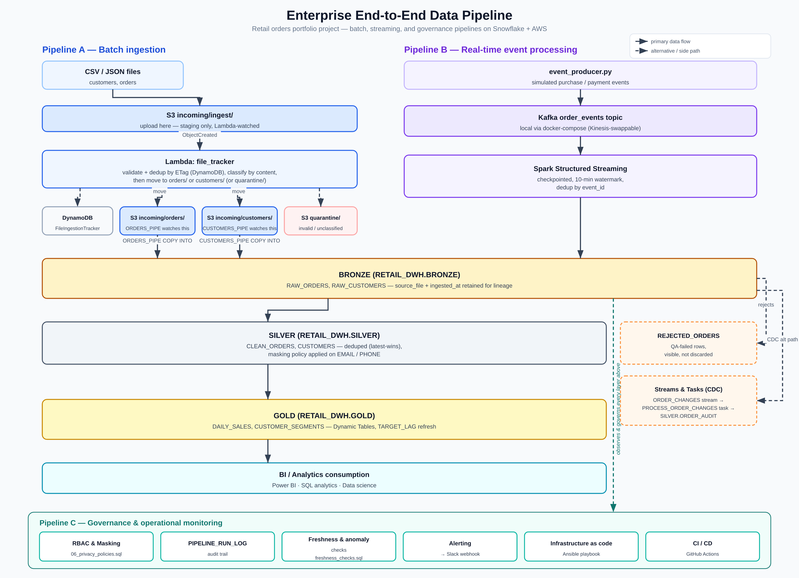

# Architecture

## Business scenario

A retailer needs reliable daily sales reports and near-real-time order
monitoring, without exposing customer emails/phones to every analyst, and
with visibility into missing records, duplicates, stale data, and failed
loads.

## Data flow



Generated from `docs/generate_architecture_diagram.py` (pure stdlib Python,
no deps) into `docs/img/architecture.svg`, then rasterized to the PNG above. To
update it: edit the generator script, `python docs/generate_architecture_diagram.py`,
then rasterize with any SVG renderer, e.g. `npx resvg-cli --fit-zoom 2.4 docs/img/architecture.svg docs/img/architecture.png`.

Text equivalent:

```
                      ┌─────────────────────┐
  CSV/JSON files ───▶ │ S3 incoming/ingest/  │
                      └─────────┬────────────┘
                                │ event notification
                                ▼
                      ┌─────────────────────┐
                      │ Lambda file_tracker   │  validate, classify,
                      │ (dedup, quarantine,   │  DynamoDB-track, then
                      │  DynamoDB)            │  move (not copy)
                      └────┬─────────────┬────┘
                           ▼             ▼
               ┌─────────────────┐ ┌─────────────────────┐
               │ incoming/        │ │ incoming/            │
               │ customers/       │ │ orders/              │  (Pipeline A)
               └────────┬────────┘ └─────────┬────────────┘
                event notification   event notification
                (disjoint prefix)    (disjoint prefix)
                         ▼                    ▼
               ┌─────────────────┐ ┌─────────────────────┐
               │ CUSTOMERS_PIPE   │ │ ORDERS_PIPE           │
               └────────┬────────┘ └─────────┬────────────┘
                         │                    │
  Kafka order_events ──▶ │ Spark Structured    │
  (Pipeline B)           │ Streaming ─────────▶│
                         ▼                    ▼
                      ┌─────────────────────────┐
                      │  BRONZE (raw)             │
                      └─────────────┬────────────┘
                                    ▼
                      ┌─────────────────────────┐
                      │  SILVER (clean,           │
                      │  deduped, masked)         │
                      └─────────────┬────────────┘
                                    ▼
                      ┌─────────────────────────┐
                      │  GOLD (Dynamic            │
                      │  Tables: metrics)         │
                      └─────────────┬────────────┘
                                    ▼
                         Power BI / SQL analytics
```

## Medallion layers

- **Lambda file tracking/routing** (`aws/lambda/file_tracker.py`): the only thing watching `incoming/ingest/`. Records every delivery in DynamoDB keyed by object key + ETag (duplicate detection) before touching the file, quarantines anything that fails basic validation (bad extension, zero bytes) or can't be classified, and for everything else, peeks at the header/content to tell orders from customers data and moves it to `incoming/orders/` or `incoming/customers/`. `ORDERS_PIPE` and `CUSTOMERS_PIPE` each have their own notification, scoped to their own prefix only, never `incoming/ingest/` - keeping all three notifications on disjoint prefixes avoids S3's restriction on overlapping notification rules. See `aws/s3_setup.md`.
- **Bronze** (`snowflake/01_database_setup.sql`, `02_bronze_ingestion.sql`): raw landing tables, append-only, source filename + ingestion timestamp retained for lineage.
- **Silver** (`snowflake/03_silver_transformations.sql`): deduplicated views (`CLEAN_ORDERS`, `CUSTOMERS`), masking applied at the base-table level, rejected rows visible via `REJECTED_ORDERS` rather than silently dropped.
- **Gold** (`snowflake/04_gold_metrics.sql`): business metrics as Dynamic Tables (`DAILY_SALES`, `CUSTOMER_SEGMENTS`), refreshed on a `TARGET_LAG`.
- **CDC variant** (`snowflake/05_streams_tasks.sql`): Streams + Tasks demonstrate the procedural alternative to Dynamic Tables for an audit trail.

## Cross-cutting controls

| Control | Where |
|---|---|
| Least-privilege access | `snowflake/06_privacy_policies.sql` (INGEST/TRANSFORM/ANALYST/PII_ACCESS roles) |
| PII masking | `snowflake/06_privacy_policies.sql` (email/phone masking policies) |
| Data quality | `tests/test_silver_data_quality.py`, `snowflake/03_silver_transformations.sql` (`REJECTED_ORDERS`) |
| Freshness / anomaly detection | `monitoring/freshness_checks.sql` |
| Alerting | `monitoring/alerting.py` |
| Auditability | `RAW_ORDERS.SOURCE_FILE`/`INGESTED_AT`, `PIPELINE_RUN_LOG`, DynamoDB `FileIngestionTracker` (every delivery, independent of whether Snowpipe loaded it) |
| Idempotent ingestion | Lambda dedup-by-ETag (`aws/lambda/file_tracker.py`), COPY INTO file tracking, Silver dedup |
| Infrastructure as code | `infrastructure/provision_aws.yml` |
| CI/CD | `.github/workflows/` |

See `docs/data_dictionary.md` for table-level ownership/sensitivity and
`docs/incident_runbook.md` for what to do when something breaks.
